# Manuale di Livery Designer

Guida completa, pensata per chi **non ha mai usato un programma di grafica**. Non serve
conoscere Photoshop o GIMP: qui si lavora a click, e ogni cosa che fai la vedi subito.

Se ti sei appena fermato davanti all'avviso di Windows durante l'installazione, la risposta è
nella [guida all'installazione](INSTALLAZIONE.md).

---

## Indice

1. [Come ragiona l'app (leggi questo per primo)](#1-come-ragiona-lapp)
2. [Primo avvio e chiave](#2-primo-avvio-e-chiave)
3. [La schermata, in sei zone](#3-la-schermata-in-sei-zone)
4. [Scegliere la vettura](#4-scegliere-la-vettura)
5. [Passo 0 — Partire da una livrea pronta](#5-passo-0--partire-da-una-livrea-pronta)
6. [Passo 1 — Il colore di fondo](#6-passo-1--il-colore-di-fondo)
7. [Colorare: i sei strumenti](#7-colorare-i-sei-strumenti)
8. [Sfumature, trame e cromature](#8-sfumature-trame-e-cromature)
9. [Passo 2 — Loghi e adesivi](#9-passo-2--loghi-e-adesivi)
10. [Passo 3 — Testi e numeri](#10-passo-3--testi-e-numeri)
11. [Passo 4 — Disegni geometrici](#11-passo-4--disegni-geometrici)
12. [I materiali: carbonio, cromo, vinile](#12-i-materiali-carbonio-cromo-vinile)
13. [Zone protette e controllo FIA](#13-zone-protette-e-controllo-fia)
14. [Annullare, salvare, riaprire](#14-annullare-salvare-riaprire)
15. [Portarla in gioco](#15-portarla-in-gioco)
16. [Se stai usando la prova gratuita](#16-se-stai-usando-la-prova-gratuita)
17. [Scorciatoie da tastiera](#17-scorciatoie-da-tastiera)
18. [Problemi frequenti](#18-problemi-frequenti)

---

## 1. Come ragiona l'app

Questa è l'unica cosa che conviene capire prima di toccare qualcosa. Dopo, tutto il resto
diventa ovvio.

La vettura che vedi nell'app **non è un modello 3D girevole**: è la sua carrozzeria *aperta e
stesa in piano*, come la pelle di un pallone da calcio srotolata sul tavolo. I tecnici la
chiamano mappa UV; a te basta sapere che è la **superficie dell'auto distesa**.

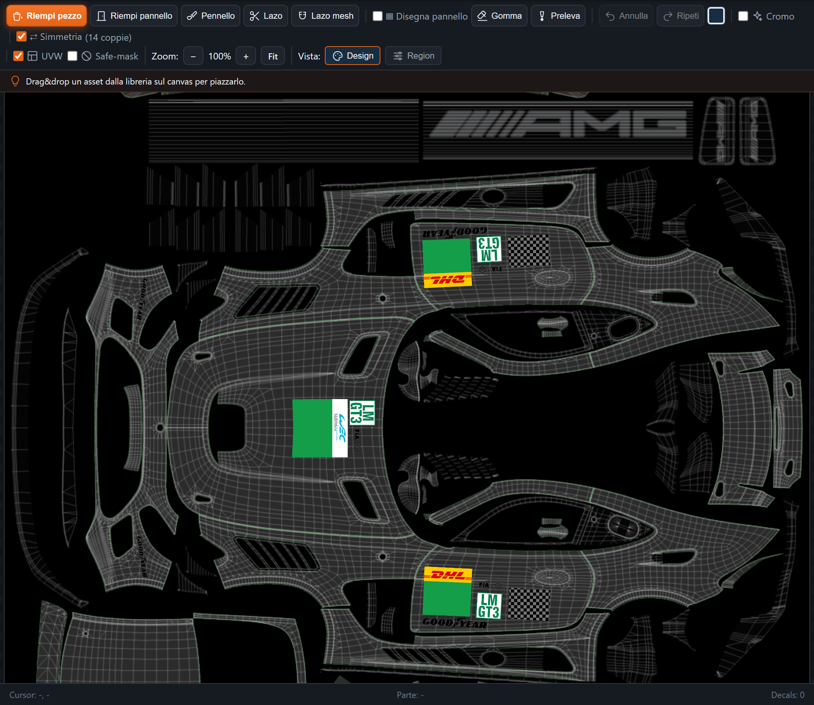

Quando dipingi su quella mappa, il gioco la riavvolge sulla macchina. Un pezzo colorato sulla
mappa diventa un pezzo colorato sull'auto, nella stessa posizione.

Due parole che userò spesso:

- **Pezzo**: la più piccola area che l'app riconosce da sola — un cofano, una fiancata, un
  cerchio del parafango. Ci clicchi sopra e si colora tutto, già ritagliato.
- **Pannello**: un gruppo di pezzi che nella realtà sono una lamiera sola.

Non devi ritagliare niente a mano: le forme l'app le conosce già, vettura per vettura.

---

## 2. Primo avvio e chiave

Alla prima apertura l'app chiede la **chiave di licenza**. Incollala e premi Attiva: serve
internet solo in quel momento, poi puoi lavorare anche offline.

Subito dopo si apre la finestra di benvenuto, che riassume i passi principali. La puoi
richiamare quando vuoi dal pulsante **Guida**, in alto.

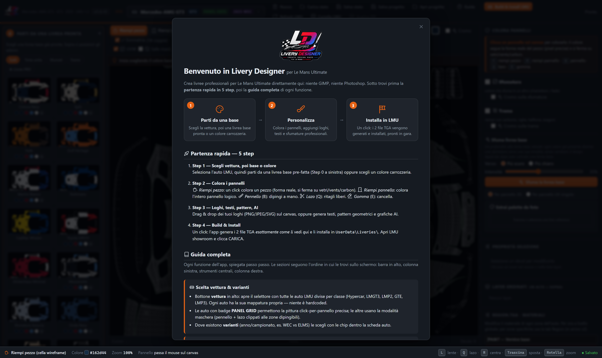

> La chiave è legata al **tuo computer**. Se cambi PC, scrivimi su
> [Discord](https://discord.gg/emM5QUXczS) e la sposto.

---

## 3. La schermata, in sei zone

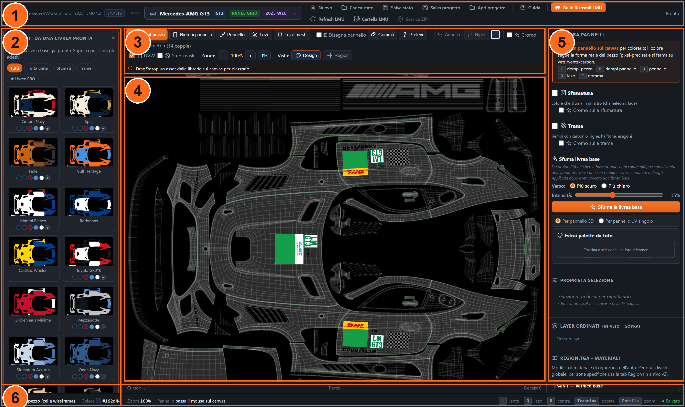

| | zona | a cosa serve |
|---|---|---|
| **1** | Barra in alto | nuovo progetto, salva, apri, **Build & Install LMU**, cartella del gioco, Guida |
| **2** | Colonna sinistra | i cinque passi numerati: livrea pronta, colore di fondo, loghi, testi, disegni |
| **3** | Strumenti | pennelli e riempimenti, annulla/ripeti, simmetria, zoom, vista Design/Region |
| **4** | Area di disegno | la vettura distesa: è qui che si lavora |
| **5** | Colonna destra | colore dei pannelli, sfumature, trame, proprietà dell'oggetto selezionato, materiali |
| **6** | Barra in basso | strumento attivo, colore corrente, zoom, scorciatoie e stato di salvataggio |

La **colonna sinistra è numerata da 0 a 4 apposta**: seguendo quei numeri dall'alto in basso
ottieni una livrea completa senza sapere nient'altro.

---

## 4. Scegliere la vettura

Clicca il nome della vettura, in alto al centro. Si apre l'elenco diviso per classe —
Hypercar, LMGT3, LMP2 e le altre.

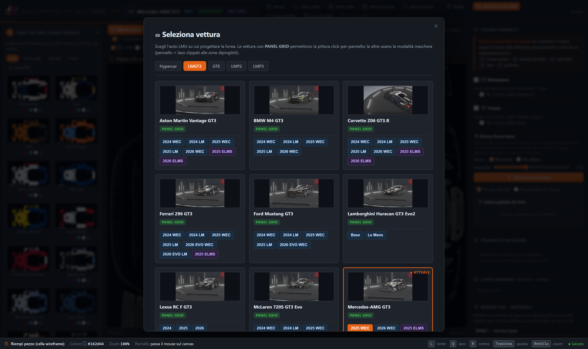

Due dettagli utili:

- L'etichetta verde **PANEL GRID** indica le vetture su cui l'app riconosce ogni singolo
  pannello: lì il riempimento a click è chirurgico. Sulle altre si lavora a pennello e lazo.
- Dove esiste più di un'**annata o campionato** (per esempio *2025 WEC* e *2026 ELMS*) la
  scegli dalle etichette accanto al nome: cambiano i cartelli del numero gara e, su alcune
  auto, la carrozzeria stessa.

Cambiare vettura azzera il lavoro in corso: scegli prima, dipingi dopo.

---

## 5. Passo 0 — Partire da una livrea pronta

È il modo più rapido per avere qualcosa di bello in trenta secondi: scegli una livrea già
fatta e poi la modifichi.

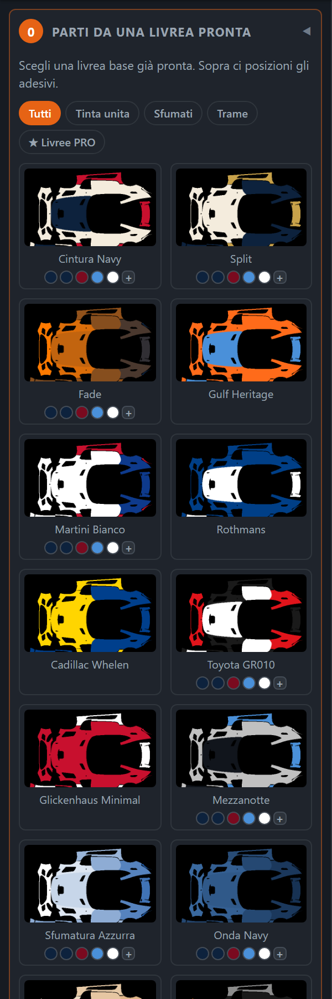

1. Usa i filtri in alto — **Tutti**, *Tinta unita*, *Sfumati*, *Trame*, **★ Livree PRO** — per
   restringere la scelta.
2. Clicca una miniatura. I pallini colorati sotto il nome sono le **varianti di colore** della
   stessa livrea: cliccane uno per cambiarle palette, o il **+** per un colore tuo.
3. Premi **Carica base selezionata sul canvas**.

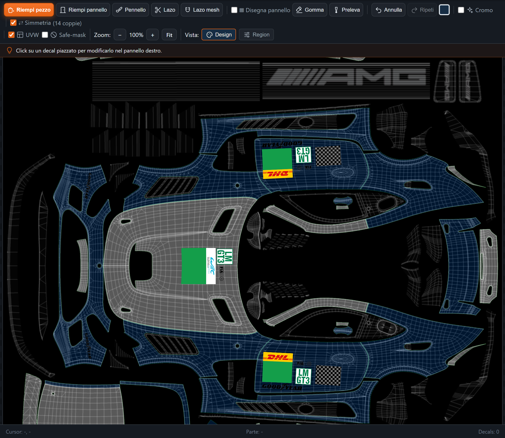

Sotto al pulsante trovi i comandi per lavorarci sopra:

- **+ Aggiungi una trama** / **+ Aggiungi un disegno**: applicano carbonio, fibra, righe o altri
  motivi *sopra* la base.
- **Riapplica**: ridipinge la base da zero. ⚠️ Le modifiche fatte a mano dopo il caricamento
  **vanno perse** — è scritto anche nell'app.
- **Ripristina**: riporta la base com'era appena caricata.
- **Opacità base**: la rende semitrasparente, comodo per ricalcarci sopra.
- **Rimuovi base livrea**: la toglie e resti con la tela pulita.

---

## 6. Passo 1 — Il colore di fondo

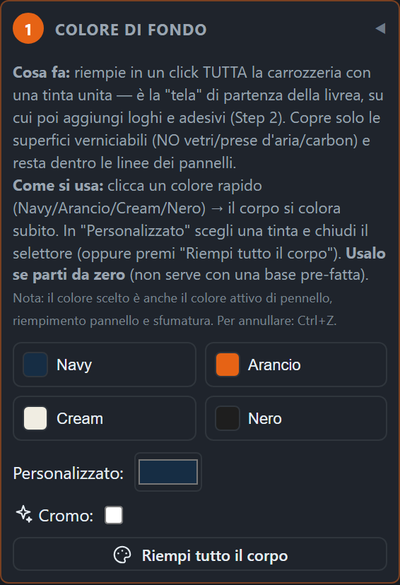

Qui scegli la tinta della carrozzeria e la applichi a tutta l'auto in un colpo. È il punto di
partenza quando **non** usi una livrea pronta: prima il fondo, poi i dettagli.

C'è anche **Estrai palette da foto** (colonna destra): trascini la foto di un'auto o di
un'immagine che ti piace e l'app ne ricava i colori, pronti da usare. Utile per riprodurre una
livrea reale senza indovinare le tinte a occhio.

---

## 7. Colorare: i sei strumenti

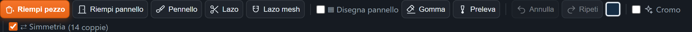

| strumento | tasto | cosa fa |
|---|---|---|
| **Riempi pezzo** | `F` | un click colora **un pezzo**, seguendone la forma reale. Si ferma da solo su vetri, prese d'aria e carbonio |
| **Riempi pannello** | `M` | colora l'**intero pannello logico**: più pezzi insieme, quelli che nella realtà sono una lamiera sola |
| **Pennello** | `B` | dipingi a mano libera. La dimensione si regola accanto allo strumento |
| **Lazo** | `Q` | disegni un contorno libero e ciò che resta dentro si colora |
| **Lazo mesh** | — | come il lazo, ma si aggancia alle celle della griglia: bordi netti senza mano ferma |
| **Gomma** | `E` | cancella. Funziona a click singolo, trascinando o a lazo |
| **Preleva** | `I` | prende un colore già presente sul disegno e lo rende attivo |

Nella colonna destra, in alto, l'app ti ricorda sempre quale strumento fa cosa:

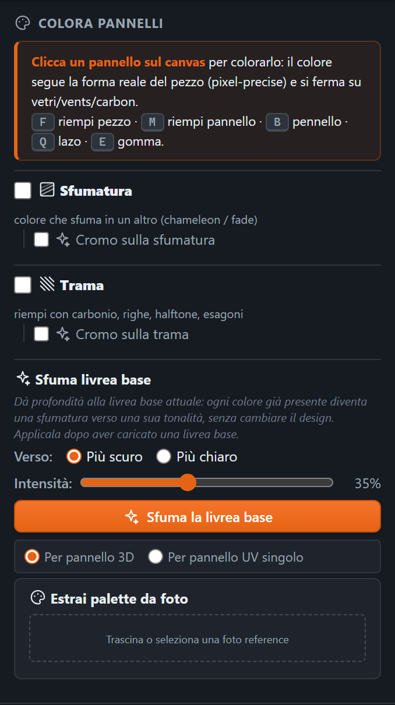

### Le tre opzioni che cambiano tutto

- **Simmetria** — con la spunta attiva, quello che dipingi a sinistra compare identico a
  destra. L'app sa quali pezzi sono gemelli (nell'esempio, *14 coppie*). Per una livrea da
  gara la vuoi quasi sempre accesa.
- **UVW** — mostra la trama a griglia che vedi sopra la vettura: è il reticolo della
  carrozzeria, aiuta a capire dove finisce un pezzo. Non viene stampato sulla livrea.
- **Safe-mask** — evidenzia le **zone protette**, quelle che non si possono dipingere
  (vedi il [punto 13](#13-zone-protette-e-controllo-fia)).

### Muoversi nel disegno

Zoom con la **rotella** del mouse, oppure con i pulsanti `−` `+`; **Fit** rimette tutta la
vettura dentro lo schermo. Si sposta la vista **trascinando** col mouse. `R` ricentra.

---

## 8. Sfumature, trame e cromature

Stanno nella colonna di destra, e sono il modo più veloce per far sembrare "professionale" una
livrea semplice.

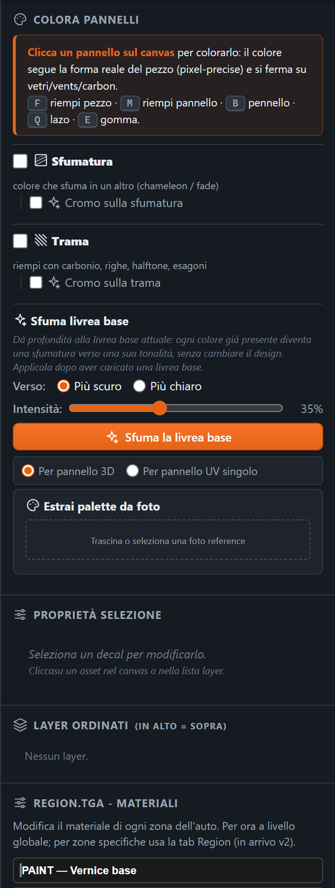

- **Sfumatura** — un colore che sfuma in un altro. Scegli i due (o più) colori, il verso e
  l'angolo. Puoi applicarla a tutta l'auto o a un pezzo solo.
- **Trama** — riempie con un motivo: carbonio, fibra, righe, esagoni, squame e decine di altri.
  Hai anche dei **preset** pronti, che sono ricetta completa (motivo + colori + scala).
- **Cromo sulla sfumatura / Cromo sulla trama** — le spunte che aggiungono l'effetto metallico.
- **Sfuma livrea base** — dà profondità a ciò che hai già dipinto: ogni colore presente diventa
  una sfumatura verso una propria tonalità, **senza cambiare il disegno**. Scegli *Più scuro* o
  *Più chiaro* e l'intensità. Si usa alla fine, quando la livrea ti piace già.

---

## 9. Passo 2 — Loghi e adesivi

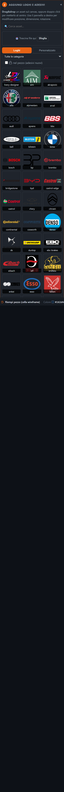

Due schede: **Loghi** (la libreria inclusa) e **Personalizzato** (i tuoi file). Cerchi col
campo di ricerca, poi:

- **trascini** il logo sulla vettura, oppure **doppio click** per piazzarlo al centro;
- puoi caricare i tuoi file **PNG, JPEG o SVG** trascinandoli direttamente nella finestra.

Una volta piazzato, l'adesivo si seleziona con un click e si modifica nel riquadro
**Proprietà selezione**:

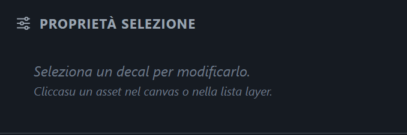

Posizione, dimensione, rotazione, opacità, specchiatura orizzontale o verticale, **tinta** (per
ricolorare un logo bianco), fusione col fondo, duplica, porta avanti o indietro, elimina.

L'ordine degli adesivi si vede e si cambia nell'elenco **Layer ordinati**: chi sta in alto nella
lista sta sopra agli altri sulla vettura.

---

## 10. Passo 3 — Testi e numeri

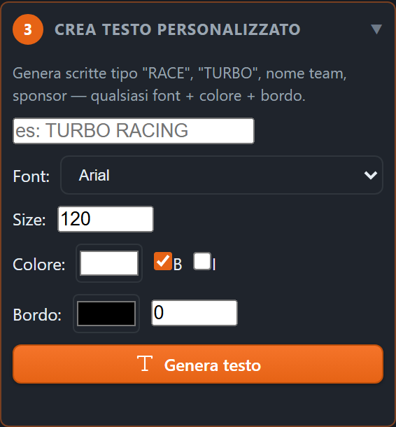

Scrivi il testo, scegli carattere, dimensione e colore, grassetto o corsivo, e il contorno con
il suo spessore. Premi genera: diventa un adesivo come gli altri, che puoi spostare, ruotare e
ridimensionare.

> Il **numero di gara** sulle targhe regolamentari lo mette il gioco: quelle aree sono protette
> e non vanno coperte (vedi il punto 13).

---

## 11. Passo 4 — Disegni geometrici

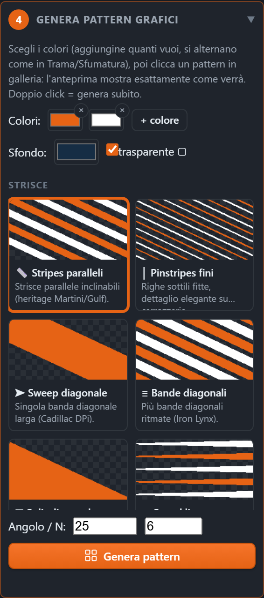

Un generatore per creare al volo motivi a due colori — righe, frecce, chevron, scacchi, sweep —
scegliendo numero, angolo e colori. Il risultato finisce fra i tuoi adesivi personalizzati,
pronto da piazzare.

È il modo semplice per fare fasce e bandiere senza disegnarle a mano.

---

## 12. I materiali: carbonio, cromo, vinile

Una livrea non è solo colore: il gioco vuole sapere anche **di che materiale** è ogni zona. Ci
pensa la seconda mappa che l'app genera da sola, e che puoi regolare qui:

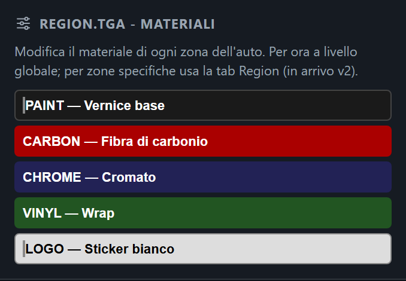

| materiale | effetto in gioco |
|---|---|
| **PAINT** | vernice normale |
| **CARBON** | fibra di carbonio a vista |
| **CHROME** | cromato, riflettente |
| **VINYL** | wrap, meno lucido della vernice |
| **LOGO** | sticker bianco |

La scheda **Region**, in alto accanto a *Design*, mostra questa seconda mappa:

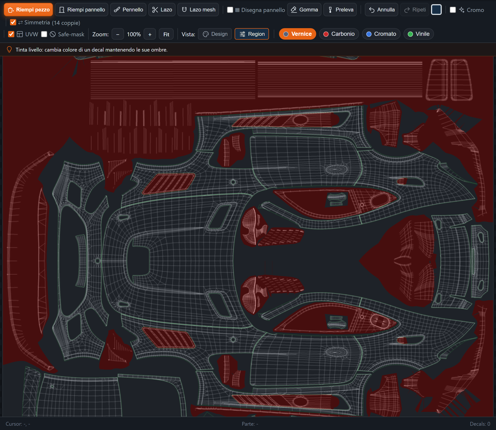

Se non la tocchi, va benissimo lo stesso: l'app assegna i materiali corretti da sola.

---

## 13. Zone protette e controllo FIA

Alcune aree della vettura **non si possono dipingere**, e l'app te lo impedisce: le targhe del
numero di gara, i loghi obbligatori del campionato, le parti in carbonio strutturale. Se provi
a colorarle, compare un avviso e il colore non viene applicato. Non è un difetto: una livrea che
le copre verrebbe rifiutata.

Quando premi **Build & Install**, prima di costruire parte un controllo:

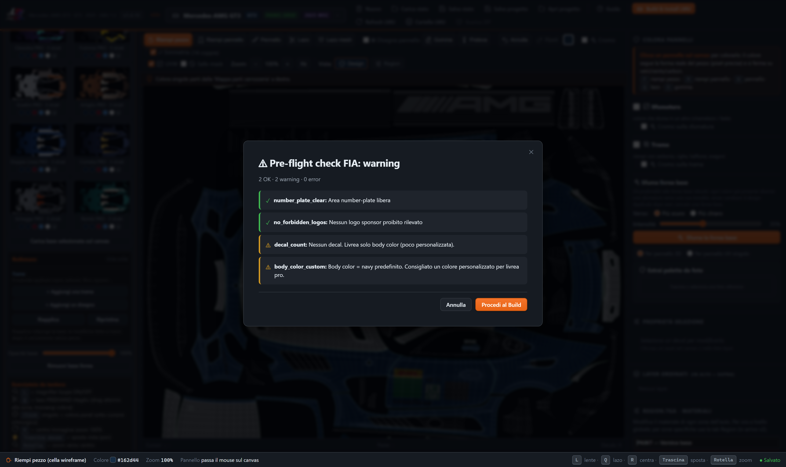

- ✅ **number_plate_clear** — l'area del numero di gara è libera
- ✅ **no_forbidden_logos** — nessun logo vietato fra quelli piazzati
- ⚠️ **decal_count** — avvisi sul numero di adesivi
- ⚠️ **body_color_custom** — ti ricorda che il colore di fondo è ancora quello predefinito

I **✓ verdi** sono controlli passati, i **⚠ gialli** sono consigli (puoi proseguire lo stesso,
con **Procedi al Build**), i **🛑 rossi** bloccano: vanno sistemati prima.

---

## 14. Annullare, salvare, riaprire

- **Annulla** e **Ripeti** (nella barra degli strumenti) tornano indietro su tutto: colori,
  adesivi, spostamenti, rotazioni.
- **Salva progetto** mette da parte il lavoro completo, riapribile e modificabile.
  **Apri progetto** lo recupera.
- **Salva stato** / **Carica stato** servono per una fotografia rapida del lavoro in corso.
- **Nuovo** riparte da zero.

In basso a destra l'app mostra **Salvato** quando il lavoro è al sicuro.

---

## 15. Portarla in gioco

1. Premi **Build & Install LMU**, in alto a destra.
2. Passa il controllo descritto sopra e premi **Procedi al Build**.
3. L'app genera i due file che il gioco vuole — `customskin.tga` e `customskin_region.tga`, in
   TGA non compresso — e li **installa da sola** nella cartella delle livree di Le Mans
   Ultimate. Non devi spostare niente a mano.
4. Apri il gioco, vai nello showroom e **carica** la livrea.

Se l'app non trova il gioco, indicale tu la cartella con **Cartella LMU**. **Refresh LMU**
rilegge le livree già presenti.

**Scarica ZIP** serve invece a portarti via i file, per condividerli o archiviarli.

---

## 16. Se stai usando la prova gratuita

La prova dura **7 giorni** e ti lascia usare tutto l'editor: vetture, varianti, preset,
disegno a mano, salvataggio e riapertura dei progetti.

Due limiti, che riguardano solo l'uscita dei file:

- puoi **caricare 3 livree dentro il gioco** — il contatore lo vedi in alto;
- **Scarica ZIP** e il salvataggio dei file sul disco sono riservati alla licenza completa.

Alla scadenza **le tue livree restano salvate**: il giorno in cui attivi la licenza completa le
riapri esattamente dove le avevi lasciate, senza rifare niente.

La prova vale **una volta per computer**.

---

## 17. Scorciatoie da tastiera

| tasto | azione |
|---|---|
| `F` | riempi pezzo |
| `M` | riempi pannello |
| `B` | pennello |
| `Q` | lazo |
| `E` | gomma |
| `I` | preleva colore |
| `L` | lente d'ingrandimento |
| `R` | ricentra la vista al 100% |
| trascina il mouse | sposta la vista |
| rotella | zoom |

---

## 18. Problemi frequenti

**Clicco su una zona e non si colora.**
È una zona protetta (targa del numero, logo obbligatorio, carbonio strutturale). Attiva
*Safe-mask* per vederle tutte evidenziate.

**Ho caricato una livrea pronta e poi ho premuto Riapplica: ho perso il lavoro.**
*Riapplica* ridipinge la base da zero. Usa **Annulla** subito: torna indietro.

**Il colore sborda dove non voglio.**
Stai usando il pennello a mano libera: passa a **Riempi pezzo** (`F`), che segue da solo i
contorni reali.

**Ho dipinto solo da un lato e si è colorato anche l'altro.**
È la **Simmetria**: toglie la spunta se vuoi un disegno asimmetrico.

**L'app non trova Le Mans Ultimate.**
Indica la cartella a mano con **Cartella LMU**.

**La livrea in gioco non si vede / è quella vecchia.**
Nello showroom del gioco va **ricaricata** dopo ogni Build.

**Ho esaurito i 3 caricamenti della prova.**
Puoi continuare a disegnare e salvare per tutti i 7 giorni. Per caricarne altre serve la
licenza completa.

---

Qualunque cosa non torni, scrivimi su **[Discord](https://discord.gg/emM5QUXczS)**: rispondo io.
